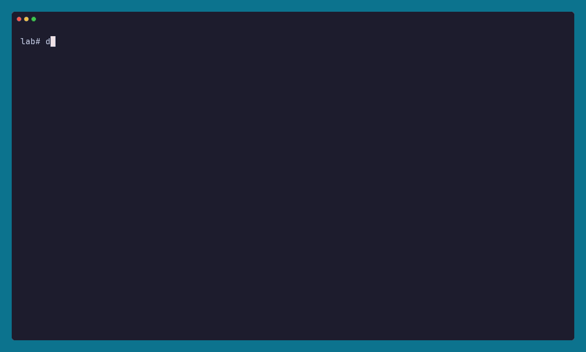
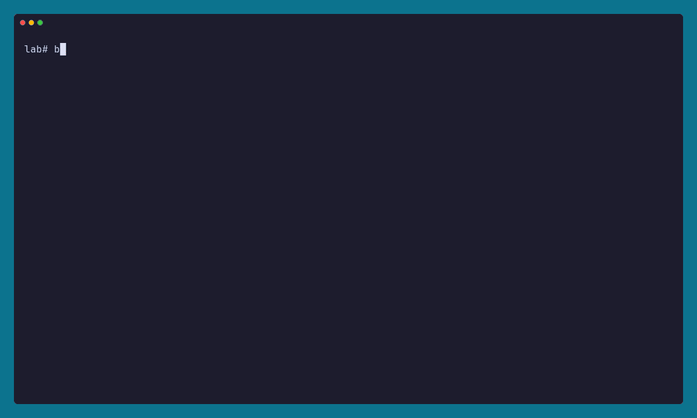
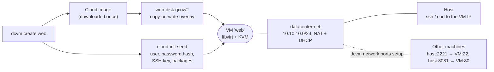
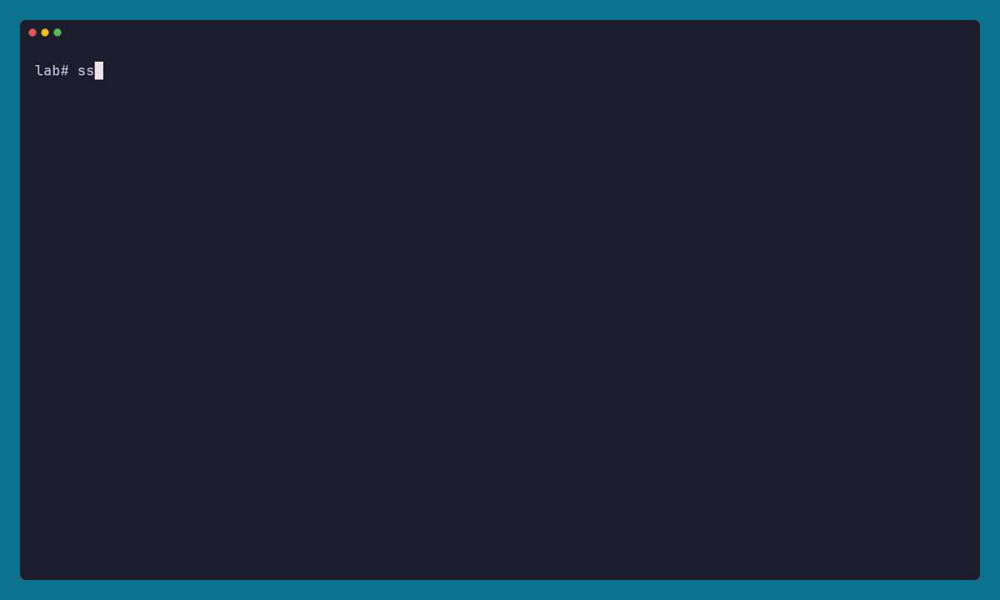

<div align="center">

# dcvm

**Ready Linux VMs on your own machine, one command each.**

[](https://github.com/metharda/dcvm/actions/workflows/test.yaml)
[](https://github.com/metharda/dcvm/releases)
[](docs/architecture.md)
[](LICENSE)



</div>

dcvm turns one Linux machine into a small VM lab. `dcvm create web` builds a
VM from a Debian, Ubuntu, Arch Linux or Kali Linux cloud image, creates your
user with a password and SSH key, installs the packages you asked for, and
puts the VM on a private network. It's for students, homelabs, CTF and
security practice, and anyone who wants a throwaway Linux box to try things
on. Under the hood it's Bash on top of KVM/QEMU and libvirt, so every VM is an
ordinary libvirt domain.

- **One command, ready VM.** Eight built-in cloud images (Debian 11/12/13,
  Ubuntu 20.04/22.04/24.04, Arch Linux, Kali Linux). `dcvm create` returns in
  about two seconds once the image is downloaded, and the VM finishes its
  first boot about a minute later.
- **Set up on first boot.** User, password (stored only as a hash), SSH key,
  static IP or DHCP, and `-k` packages, with nginx, Apache, MySQL/MariaDB,
  Docker and Tailscale set up for you.
- **Private by default.** VMs sit on a NAT network (`10.10.10.0/24`); one
  command forwards SSH and HTTP ports from the host when you want them
  reachable.
- **Break it, get it back.** Backups, restore in place or as a copy,
  export/import between hosts.
- **Any installer ISO.** `dcvm create-iso` boots Windows or any other
  installer with VNC, SPICE or a serial console.
- **No lock-in.** No daemon or database; `virsh` and virt-manager keep
  working on every VM.

## Quick start

**You need:** an x86_64 Linux host (Debian/Ubuntu or Arch based) with
VT-x/AMD-V enabled, root access and an internet connection.

```bash
sudo -i   # the installer runs as root
bash -c "$(curl -fsSL https://raw.githubusercontent.com/metharda/dcvm/main/lib/installation/install-dcvm.sh)"
```

> [!TIP]
> Prefer to read the installer before it runs as root? Download it first:
> `curl -fsSL -o install-dcvm.sh https://raw.githubusercontent.com/metharda/dcvm/main/lib/installation/install-dcvm.sh && less install-dcvm.sh && sudo bash install-dcvm.sh`.
> It then fetches the rest of dcvm from the same repository and branch. See
> [Installation](docs/installation.md) for a manual install from a clone.

<div align="center">

<br>
<sub>Fresh Ubuntu 24.04 host, all installer defaults. Recorded in real time (about 2 minutes, mostly <code>apt</code>) and played back 6× faster.</sub>
</div>

The installer asks a few questions; the defaults are fine. It installs
QEMU/KVM, libvirt and the image tools, creates the `datacenter-net` network
and `/srv/datacenter`, and installs the `dcvm` command.

**Next steps**

```bash
read -rs VM_PASSWORD && export VM_PASSWORD     # the VM user's password, not echoed
dcvm create web -f -p "$VM_PASSWORD" -k nginx --ip 10.10.10.50
curl 10.10.10.50                               # after about a minute of first boot
ssh ubuntu@10.10.10.50                         # key login with the host root's SSH key
```

The first `dcvm create` for an OS downloads its cloud image (Ubuntu 24.04 is
about 600 MB). Run `dcvm create myvm` without flags for an interactive wizard,
and see the [Usage guide](docs/usage.md) for every option.

## How it works



1. **Image.** Each OS maps to one official cloud image, downloaded once from
   the fastest mirror into `/srv/datacenter/storage/templates`.
2. **Disk.** The VM gets a qcow2 overlay on that image, so creating it takes
   seconds and it only stores its own changes.
3. **Seed.** dcvm writes a cloud-init seed with the user, the password hash,
   your SSH key, packages and network settings.
4. **Boot.** `virt-install` defines the VM on the NAT network and sets it to
   start with the host; cloud-init finishes the setup inside the guest.

More detail, including networking and backups, is in
[Architecture](docs/architecture.md).

## Backups that bring a VM back

Practise an exploit, misconfigure a server, `rm -rf` the wrong folder: a
backup puts the VM back exactly as it was.

<div align="center">

<br>
<sub>Recorded in real time and played back 3× faster; the two waits for the VM to boot are cut.</sub>
</div>

- **Consistent.** The VM is shut down for the copy (up to 60 seconds for a
  clean shutdown), then started again. A fresh Ubuntu VM took 20 seconds to
  back up and 80 seconds to restore on the demo host.
- **In place or as a copy.** `dcvm backup restore web` replaces the VM and
  keeps its MAC address and IP. `dcvm backup restore web latest web2` creates
  a second VM with new MACs, hostname, machine-id and SSH host keys.
- **Portable.** `dcvm backup export` packs a backup into a `.tar.gz` without
  your `authorized_keys`; `dcvm backup import` restores it on another dcvm
  host.
- The 5 most recent backups of each VM are kept.

> [!IMPORTANT]
> Backups store the VM's overlay disk, not a full disk image. Restoring needs
> the same cloud image file in `storage/templates`; restore downloads it if it
> is missing, but an overlay on a newer upstream image is not reliable. Keep
> your templates, and copy them along with exports. See
> [Backups](docs/backups.md).

## Day to day

<div align="center">

<br>
<sub>Real time, nothing cut.</sub>
</div>

| Task | Command |
| :--- | :------ |
| Create (wizard / one line) | `dcvm create myvm` · `dcvm create myvm -f -p "$PASS" -o 1 -m 4096 -c 4 -d 50G` |
| Several at once | `dcvm create web,db,cache -f -p "$PASS"` |
| From an installer ISO | `dcvm create-iso win --iso /isos/windows.iso -m 8192 -d 100G` |
| List / overview | `dcvm list` · `dcvm status` |
| Start, stop, restart (one or all) | `dcvm start web` · `dcvm stop` · `dcvm restart web` |
| Serial console | `dcvm console web` (exit with `Ctrl+]`) |
| Reach VMs from the LAN | `dcvm network ports setup` · `dcvm network ports test` |
| Network, DHCP, VNC | `dcvm network` · `dcvm network dhcp show` · `dcvm network vnc enable web` |
| Back up and restore | `dcvm backup create web` · `dcvm backup list` · `dcvm backup restore web` |
| Cloud images | `dcvm template status` · `dcvm template download -a` |
| Delete | `dcvm delete web` |
| Update dcvm | `dcvm self-update --check` · `dcvm self-update` |

`-o` picks the OS: `1` Debian 13, `2` Debian 12, `3` Debian 11, `4` Ubuntu
24.04 (default), `5` Ubuntu 22.04, `6` Ubuntu 20.04, `7` Arch Linux, `8` Kali
Linux. Defaults are 2048 MB RAM, 2 vCPUs and a 30G disk (Kali needs at least
30G).

> [!WARNING]
> `dcvm delete` does not ask for confirmation; it removes the VM, its disk,
> DHCP lease and port forwards right away. Backups are kept.

## Requirements

| | |
| :--- | :--- |
| CPU | x86_64 with VT-x or AMD-V enabled (`/dev/kvm` present); nested virtualization works for a VM host |
| Memory | 4 GB minimum, 8 GB or more for several VMs (each defaults to 2 GB) |
| Disk | 50 GB or more free; each cloud image is 0.4-0.6 GB, plus what the VMs write |
| Host OS | Debian, Ubuntu or Arch Linux, or a derivative (the installer uses `apt` or `pacman`); systemd |
| Access | root, and internet for packages and images |

## Configuration

The installer writes `/etc/dcvm-install.conf` (`DATACENTER_BASE`,
`NETWORK_NAME`, `BRIDGE_NAME`, `NETWORK_SUBNET`); see
[Operations › Settings](docs/operations.md#settings). These environment
variables change behaviour:

| Variable | Default | Used by | Effect |
| :------- | :------ | :------ | :----- |
| `DCVM_REPO_SLUG` | `metharda/dcvm` | installer, `self-update` | GitHub `owner/repo` to install or update from (for forks) |
| `DCVM_REPO_BRANCH` | `main` | installer, `self-update` | Branch to install or update from |
| `SSH_PORT_START` | `2221` | `dcvm network ports setup` | First host port forwarded to a VM's port 22 |
| `HTTP_PORT_START` | `8081` | `dcvm network ports setup` | First host port forwarded to a VM's port 80 |

```bash
# Install from a fork's branch
DCVM_REPO_SLUG=you/dcvm DCVM_REPO_BRANCH=my-branch \
  bash -c "$(curl -fsSL https://raw.githubusercontent.com/you/dcvm/my-branch/lib/installation/install-dcvm.sh)"
```

> [!WARNING]
> VMs created with `-f` have root login enabled with the user's password
> unless you pass `--disable-root`, and every VM accepts SSH passwords.
> Forwarded ports listen on all host interfaces. On a host reachable from
> untrusted networks, read [Security](docs/security.md) first.

## Limitations

- One Linux x86_64 host, run as root. No macOS or Windows hosts, no clusters.
- Automatic setup covers the eight built-in images; ISO installs are manual.
- Backups are cold (the VM is shut down) and depend on the VM's cloud image
  file (see above). There are no live snapshots.
- Port forwarding covers SSH (22) and HTTP (80) for each running VM, uses
  host ports 2220-2299 and 8080-8179, and is not reapplied after a host
  reboot unless your system restores `/etc/iptables/rules.v4`
  (`dcvm network ports apply` does it by hand).
- VMs share one bridge and can reach each other.
- Cloud images are checked against the checksum files their publishers put
  next to them (SHA256SUMS, SHA512SUMS); signatures are not checked, and a
  mirror that publishes no checksum is used with a warning.
- The optional NFS share is writable by root inside the guests (`sudo`), not
  by the VM user.

## How it compares

| Tool | Good for | Hosts |
| :--- | :------- | :---- |
| **dcvm** | Ready Linux VMs from eight cloud images or any ISO, with NAT networking, port forwards, backups and export/import in one CLI | Linux with KVM/libvirt |
| [Multipass](https://documentation.ubuntu.com/multipass/en/latest/) | Cloud-style Ubuntu VMs with cloud-init, snapshots, mounts and a GUI | Linux, macOS, Windows |
| [Vagrant](https://developer.hashicorp.com/vagrant/intro) + [vagrant-libvirt](https://vagrant-libvirt.github.io/vagrant-libvirt/) | Reproducible environments described in a `Vagrantfile` you commit | Linux, macOS, Windows |
| [virt-install](https://github.com/virt-manager/virt-manager/blob/main/man/virt-install.rst) | Full control over every libvirt install method and device | Linux with libvirt |
| [quickemu](https://github.com/quickemu-project/quickemu) | Desktop VMs, including macOS and Windows guests, without root | Linux, macOS |

Choose dcvm when you want a lab on one Linux box with the image, user, key,
network and ports handled for you. Choose another tool for a macOS or Windows
host, macOS guests, an environment defined in a file, snapshots, or full
control over libvirt options.

## Documentation

| Document | What's in it |
| :------- | :----------- |
| [Installation](docs/installation.md) | Install options, what the installer does, updating, uninstalling |
| [Usage](docs/usage.md) | Every command and flag, packages, ISO installs |
| [Networking](docs/networking.md) | NAT network, static IPs, port forwarding, DHCP, VNC |
| [Backups](docs/backups.md) | Backup, restore, copies, export and import |
| [Operations](docs/operations.md) | Reading the checks, reboots, updates, logs, settings, troubleshooting |
| [Security](docs/security.md) | Threat model, credentials, network exposure, hardening |
| [Architecture](docs/architecture.md) | Components, the create flow, design decisions |
| [Development](docs/development.md) | Repository layout, workflow, re-recording these demos |
| [Examples](docs/examples/) | Web, database, Docker and networking walkthroughs |
| [Changelog](CHANGELOG.md) · [Contributing](CONTRIBUTING.md) | Release notes and how to contribute |

## License

Apache License 2.0. See [LICENSE](LICENSE).
