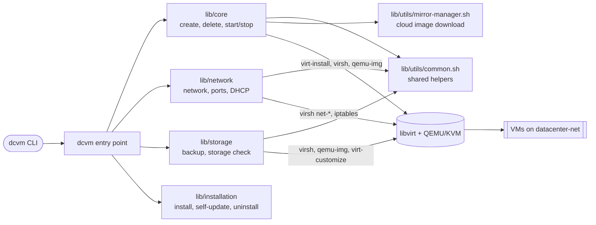
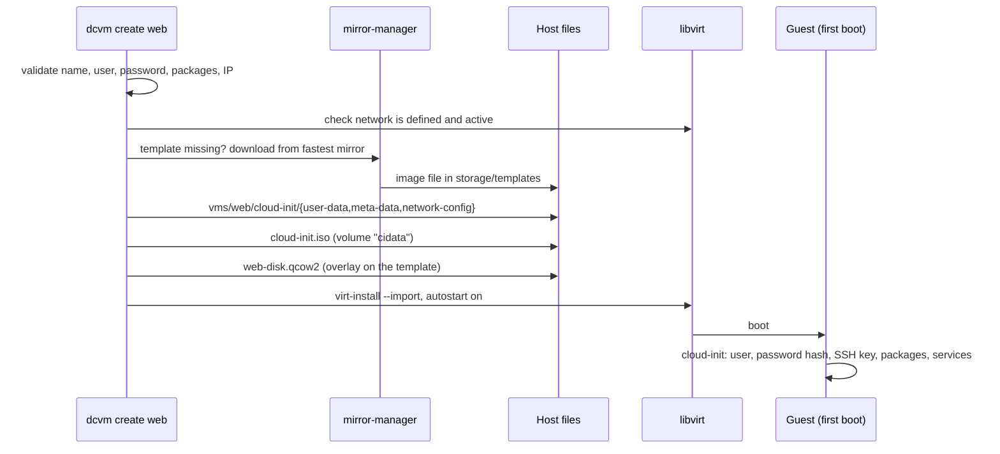
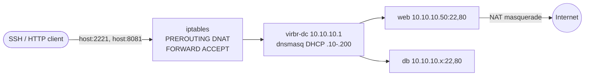
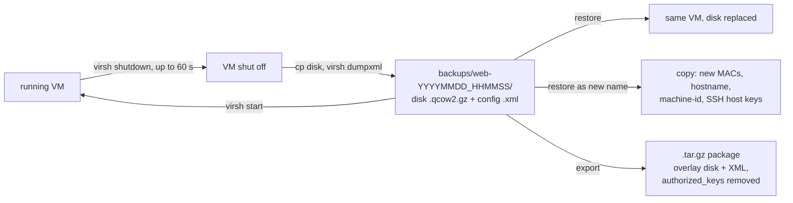

# Architecture

dcvm is a set of Bash scripts that drive KVM/QEMU through libvirt. There is no
daemon, database or agent of its own: every command is a short-lived script
that calls `virsh`, `virt-install`, `qemu-img`, `iptables` and cloud-init
tooling, and keeps its state in plain files under `DATACENTER_BASE` and in
libvirt itself.

- [Components](#components)
- [Command routing](#command-routing)
- [What `dcvm create` does](#what-dcvm-create-does)
- [Networking](#networking)
- [Backups](#backups)
- [State on the host](#state-on-the-host)
- [Design decisions](#design-decisions)

See also: [Security](security.md) · [Operations](operations.md) ·
[Development](development.md)

## Components

| Part | Files | Role |
| :--- | :---- | :--- |
| Entry point | `dcvm` | Parses the first word and `exec`s the matching script in `lib/`. Holds the version string. |
| Core | `lib/core/create-vm.sh`, `custom-iso.sh`, `delete-vm.sh`, `vm-manager.sh` | VM creation from cloud images or ISOs, deletion, list/status/start/stop/restart. |
| Network | `lib/network/network-manager.sh`, `port-forward.sh`, `dhcp.sh` | `dcvm network ...`: the libvirt NAT network, iptables port forwards, DHCP lease cleanup, VNC on/off. |
| Storage | `lib/storage/backup.sh`, `storage-manager.sh` | Backups, restore (in place or as a copy), export/import between hosts; the hourly in-guest storage check. |
| Installation | `lib/installation/install-dcvm.sh`, `self-update.sh`, `uninstall-dcvm.sh` | Host setup, updates from GitHub, removal. |
| Utilities | `lib/utils/common.sh`, `mirror-manager.sh`, `fix-lock.sh`, `dcvm-completion.sh`, `test-suite.sh` | Shared helpers and validation, image mirrors, libvirt lock repair, bash completion, the test suite. |

## Command routing

`dcvm <command>` resolves its library directory first: from
`DCVM_LIB_DIR` in `/etc/dcvm-install.conf` if set, otherwise
`/usr/local/lib/dcvm` on an installed host, or `lib/` next to the script in a
clone without a config file. It then `exec`s one script per command:

| Command | Script |
| :------ | :----- |
| `create` | `core/create-vm.sh` (hands off to `custom-iso.sh` when `-o` is an ISO path) |
| `create-iso` | `core/custom-iso.sh` |
| `delete` | `core/delete-vm.sh` |
| `list`, `status`, `start`, `stop`, `restart`, `console` | `core/vm-manager.sh` |
| `network` | `network/network-manager.sh` (delegates `ports` and `dhcp`) |
| `backup`, `restore` | `storage/backup.sh` |
| `storage`, `storage-cleanup` | `storage/storage-manager.sh` |
| `template`, `mirror` | `utils/mirror-manager.sh` |
| `fix-lock` | `utils/fix-lock.sh` |
| `self-update`, `update`, `uninstall` | `installation/` |

Every script sources `lib/utils/common.sh` and calls `load_dcvm_config`, which
reads `/etc/dcvm-install.conf` and fills in defaults for `DATACENTER_BASE`,
`NETWORK_NAME`, `BRIDGE_NAME` and `NETWORK_SUBNET`.

## What `dcvm create` does

1. **Validation.** VM names (3-64 characters of letters, digits, `_`, `-`),
   usernames, passwords, `-k` package names and `--ip` are checked before
   anything is written. A comma-separated name list (`web,db,cache`) creates
   several VMs in force mode, with incrementing static IPs if `--ip` is given.
2. **Template.** Each OS choice maps to one cloud image under
   `$DATACENTER_BASE/storage/templates`. If it is missing,
   `mirror-manager.sh` tests the mirrors for that image, picks the fastest,
   downloads to a temporary file and keeps it only if it is at least 100 MB.
   Kali ships as a `.tar.xz`, which is unpacked.
3. **cloud-init seed.** dcvm writes `user-data` (user, SHA-512 password hash,
   optional root hash, SSH key, packages, `sshd_config`, service setup),
   `meta-data` and a netplan-style `network-config` (DHCP, or the static
   address), then packs them into `cloud-init.iso` with
   `genisoimage`/`mkisofs`.
4. **Disk.** `qemu-img create -f qcow2 -b <template>` makes a copy-on-write
   overlay of the requested size, so a new VM takes seconds and only its own
   changes use disk space.
5. **Define and boot.** `virt-install --import` defines the domain with the
   overlay disk, the seed ISO as a CD-ROM, a serial console, the dcvm network
   and graphics `none` (or VNC on `127.0.0.1` for Kali and Debian 13). The VM
   is set to autostart with the host.
6. **First boot.** cloud-init inside the guest creates the user, applies the
   password hashes and SSH key, updates the package index, installs the base
   tools and each `-k` package one by one (a failure is logged to
   `/var/log/dcvm-packages.log` and does not stop the rest), and sets up
   nginx, Apache, MySQL/MariaDB or Docker when asked. This takes 1-3 minutes
   depending on packages and mirror speed.

`dcvm create-iso` (or `dcvm create -o file.iso`) skips cloud-init: it creates
an empty qcow2 disk, attaches the ISO and boots the installer with VNC, SPICE
or a serial console for you to finish by hand.

## Networking

- **NAT network.** The installer defines a libvirt network
  (`datacenter-net`, bridge `virbr-dc`, `10.10.10.0/24`, host at `.1`) with
  NAT forwarding and a dnsmasq DHCP range of `.10`-`.200`. VMs reach the
  internet through the host; nothing outside the host can reach a VM unless
  you forward a port.
- **Static IPs.** `--ip` writes the address into the guest's
  `network-config`; dnsmasq is not involved. The host keeps a record in
  `$DATACENTER_BASE/config/network/<vm>.conf`, which `dcvm network` lists
  and backup restore checks.
- **IP discovery.** `get_vm_ip` asks the guest agent, then the libvirt lease
  table, then the DHCP leases by name and MAC, and finally the static IP
  record.
- **Port forwarding.** `dcvm network ports setup` removes dcvm's old rules,
  then gives each running VM the next free pair of host ports, starting at
  2221 (SSH, to port 22) and 8081 (HTTP, to port 80). Each forward is one
  `PREROUTING` DNAT rule and one `FORWARD` ACCEPT rule. The table is saved to
  `$DATACENTER_BASE/port-mappings.txt` and, when `iptables-save` exists, the
  rules to `/etc/iptables/rules.v4`. `dcvm network ports apply` rebuilds the
  rules from the saved table.
- **DHCP cleanup.** `dcvm delete` and `dcvm network dhcp clear` release a
  lease in the running dnsmasq with `dhcp_release` and remove it from
  libvirt's status file with `jq`, under a lock, so a deleted VM's address is
  free again without restarting the network.

## Backups

- **Consistency over uptime.** A backup shuts the VM down (gracefully, forced
  after 60 seconds), copies the disk and the libvirt XML, gzips the disk, and
  starts the VM again if it was running. The guest file system is never
  copied while it is being written.
- **Retention.** The 5 most recent backups of each VM are kept; older ones are
  removed after each new backup.
- **Restore.** Restoring over an existing VM asks for confirmation and
  replaces its disk. Restoring under a new name defines a separate VM with
  new MAC addresses; when `virt-customize` is installed, its hostname,
  `/etc/hosts`, machine-id and SSH host keys are changed offline before first
  boot.
- **Overlays, not full disks.** A backup copies the VM's qcow2 overlay, which
  only holds the VM's own changes and still points at its cloud image in
  `storage/templates`. Restore needs that same image; if it is missing,
  restore downloads the current image of that name from the mirrors.
- **Export/import.** Export packs the overlay and XML into a `.tar.gz` and
  removes `authorized_keys` files from the image (with guestfish) and from the
  cloud-init seed. Import on another dcvm host restores it on top of that
  host's copy of the cloud image, downloading it if needed. The importing host
  should have the same image file the VM was built on: an overlay on a newer
  upstream image is not reliable.

See [backups.md](backups.md) for the selectors and every restore option.

## State on the host

| Path | Contents |
| :--- | :------- |
| `/etc/dcvm-install.conf` | `DATACENTER_BASE`, `NETWORK_NAME`, `BRIDGE_NAME`, `NETWORK_SUBNET` |
| `/usr/local/bin/dcvm`, `/usr/local/lib/dcvm/` | Installed CLI and libraries |
| `$DATACENTER_BASE/storage/templates/` | Downloaded cloud images (backing files for every VM disk) |
| `$DATACENTER_BASE/vms/<vm>/` | `<vm>-disk.qcow2`, `cloud-init.iso`, `cloud-init/` (mode 700) |
| `$DATACENTER_BASE/config/network/<vm>.conf` | Static IP record |
| `$DATACENTER_BASE/port-mappings.txt` | `VM_NAME VM_IP SSH_PORT HTTP_PORT`, one line per forward |
| `$DATACENTER_BASE/backups/` | Backups and `exports/` |
| `$DATACENTER_BASE/nfs-share/` | Optional NFS share, mounted in guests at `/mnt/shared` |
| `/var/lib/dcvm/backups/` | Copies of the previous install, made by `dcvm self-update` |
| `/var/log/datacenter-startup.log`, `/var/log/dcvm-backup.log`, `/var/log/datacenter-storage.log` | Logs |

libvirt holds the rest: domain definitions, the network, and the DHCP leases
in `/var/lib/libvirt/dnsmasq/<bridge>.status`.

## Design decisions

| Decision | Why | Trade-off |
| :------- | :-- | :-------- |
| Plain Bash over libvirt tools | Runs on any Linux host with libvirt, no runtime to install, and every step is a command you can run by hand. VMs stay ordinary libvirt domains, so `virsh` and virt-manager keep working. | No API; the scripts parse command output. |
| Cloud images and cloud-init instead of installers | A ready VM in about a minute plus first-boot time, with the user, key and packages already set up. | Only the eight built-in images get this; anything else goes through `create-iso` and a manual install. |
| qcow2 overlays on shared templates | New VMs are instant and small, and so are their backups. | Every VM disk and backup depends on its template file; deleting or replacing a template (for example `dcvm template download --force`) breaks those VMs. |
| Password hashes only | The guest password never appears in plain text in the seed or a guest command (see [security.md](security.md)). | The password can't be read back later; reset it inside the VM. |
| Cold backups | A powered-off copy can't be torn mid-write. | The VM is down for the length of the copy. |
| iptables DNAT for access | Works the same on every distro and needs no extra service. | Rules are global and not reloaded at boot unless your distro restores `/etc/iptables/rules.v4`; run `dcvm network ports apply` after a reboot. |
| No dcvm daemon | Nothing to keep running or secure; libvirt already autostarts the network and VMs. | Port forwards and IP discovery are refreshed on demand, not continuously. |
